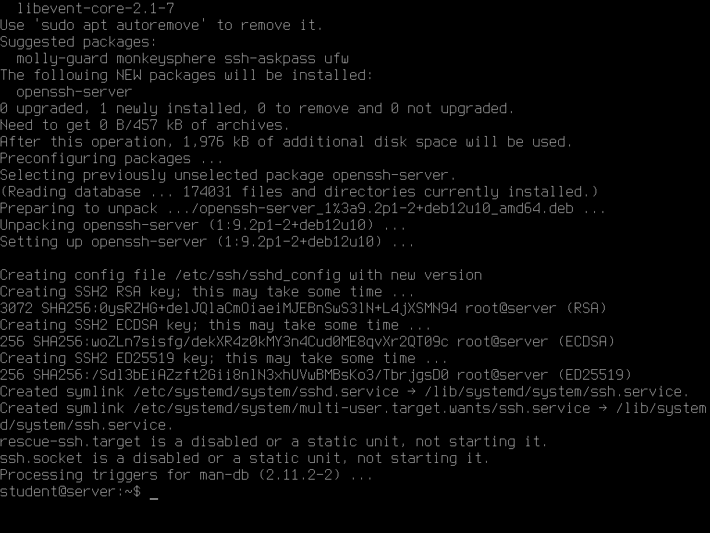
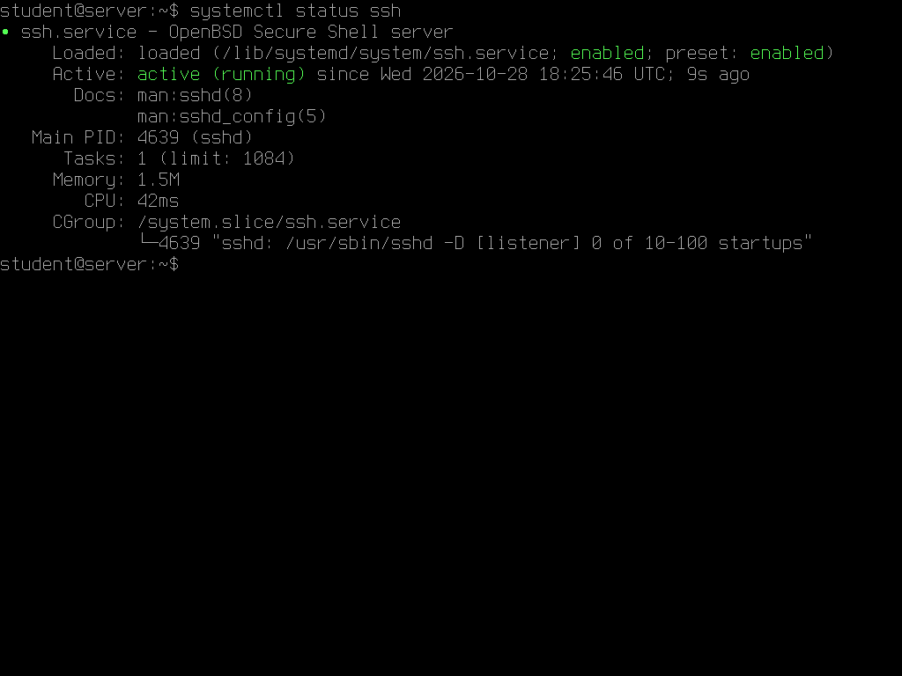
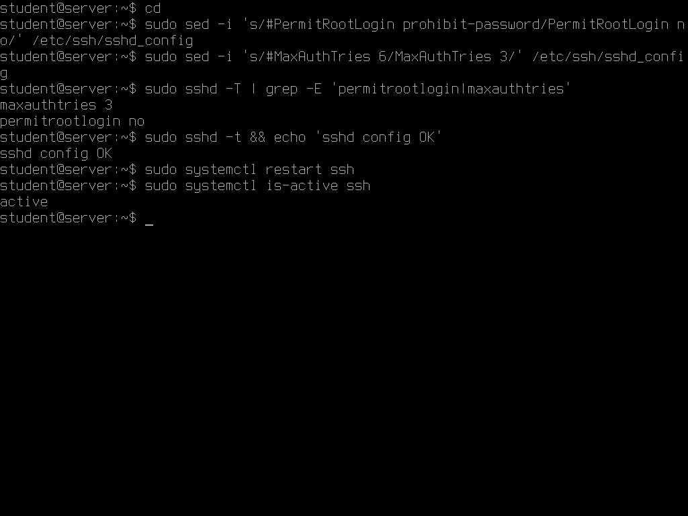
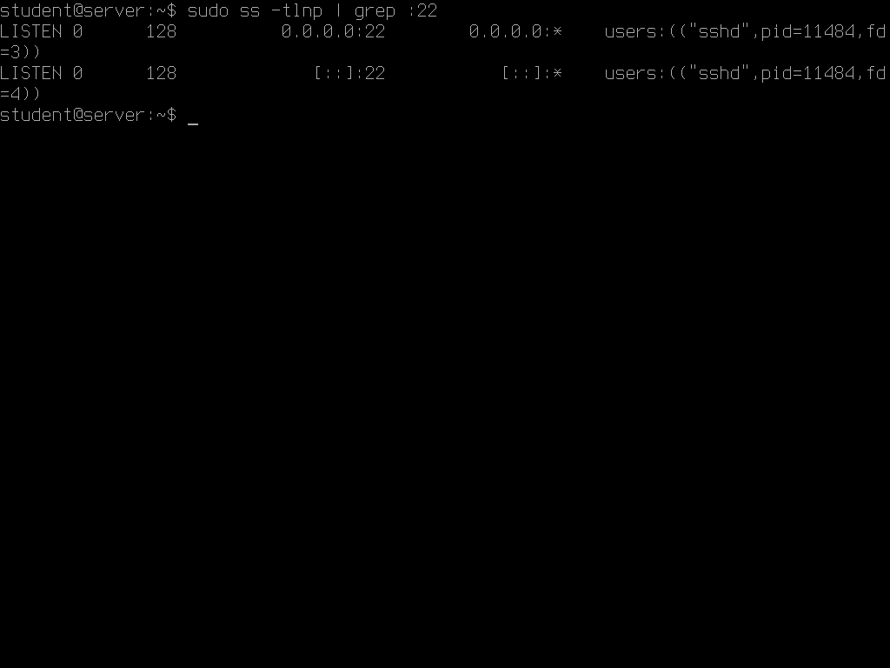
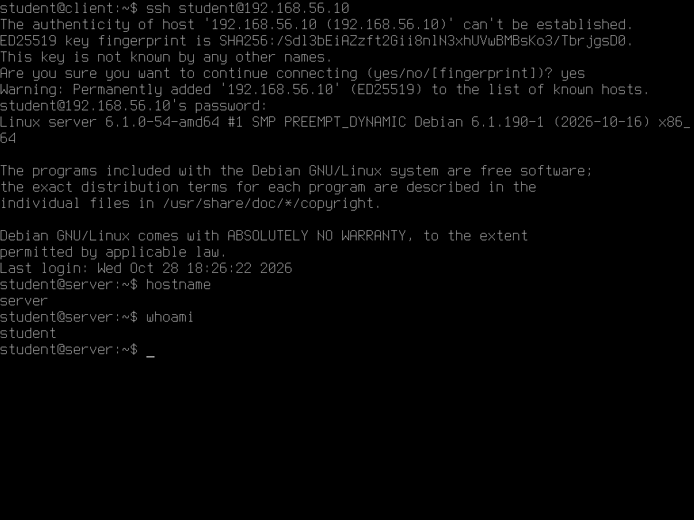
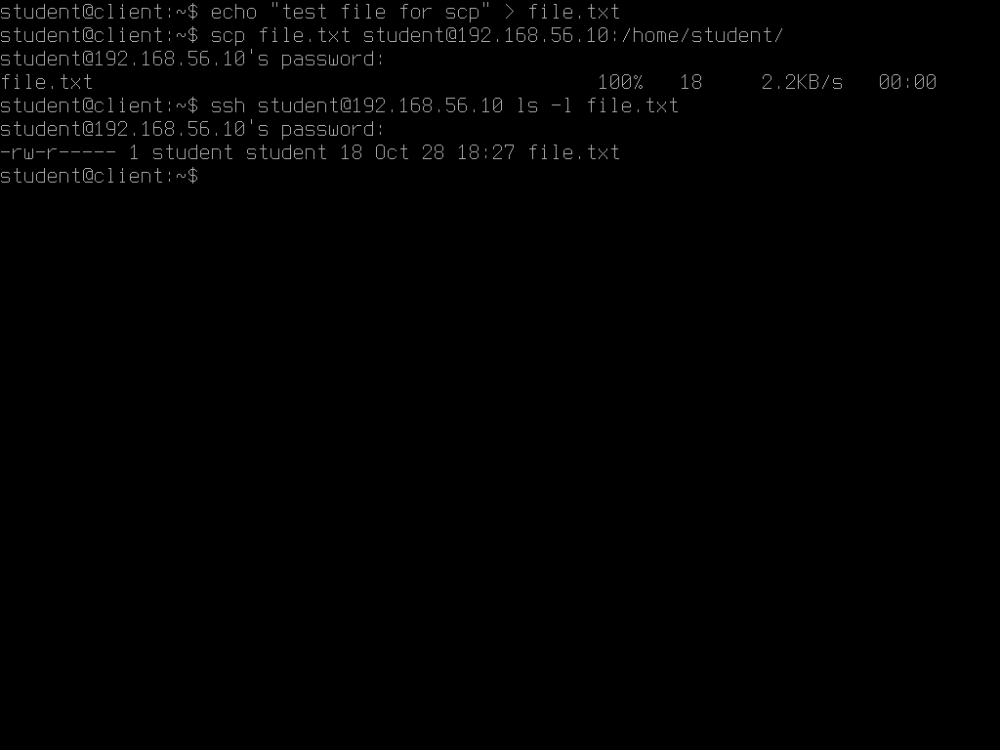
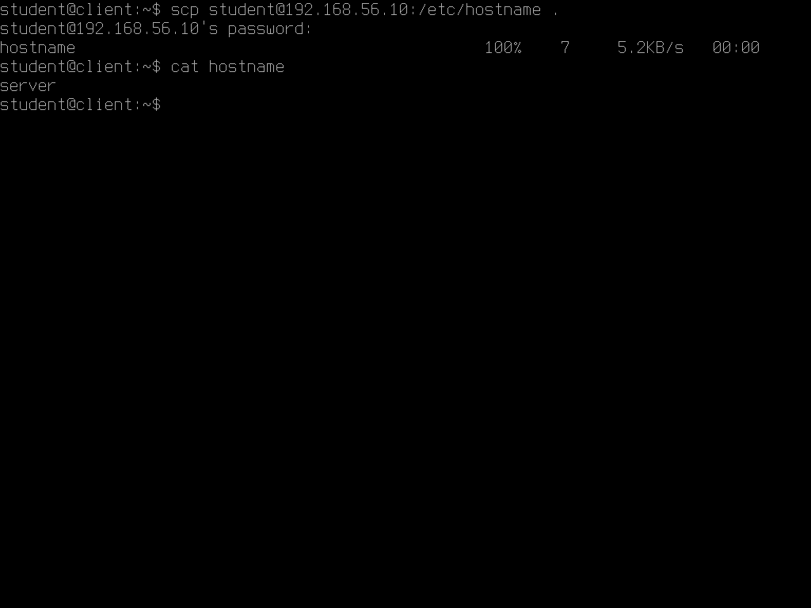
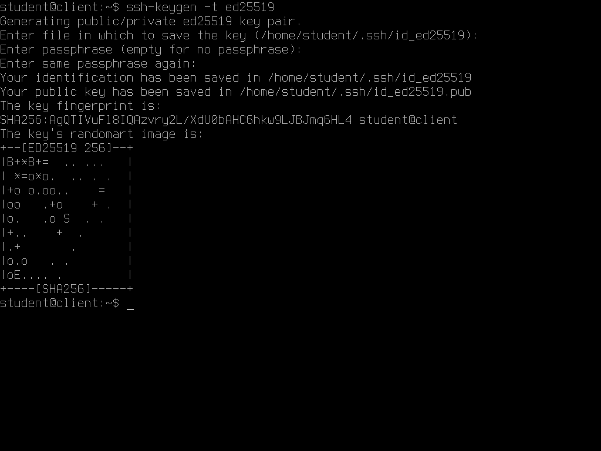
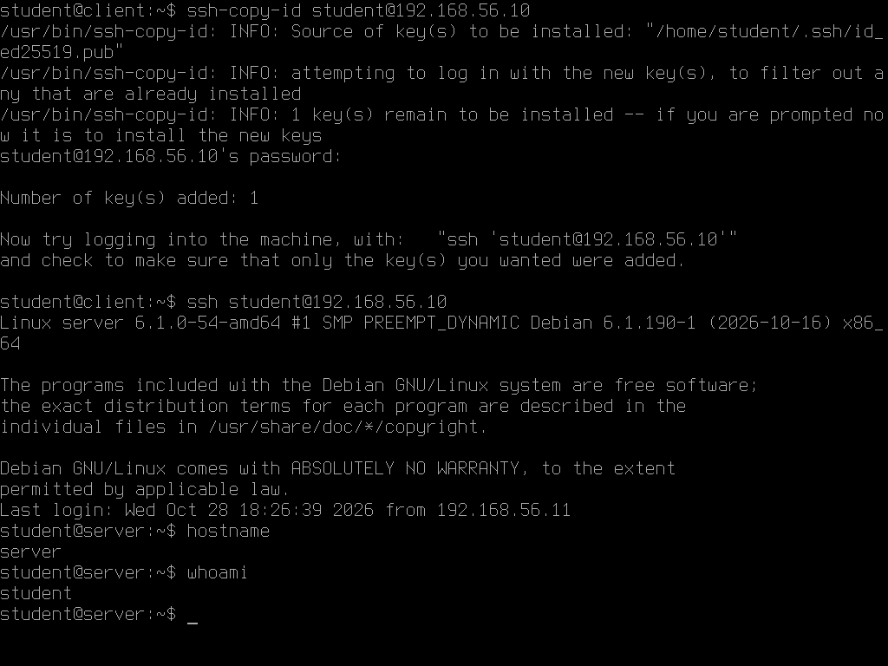

<div align="center">

<h1>SSH: установка сервера, подключение, SCP и ключи</h1>

<p>Практическое домашнее задание по теме<br>
«Работа с серверами и протокол удалённого управления SSH» — кейсы 1–4.</p>

<p>
  
  
</p>

</div>

**Репозиторий:** <https://github.com/socrabs151/urfu-ssh-practice>

---

## Содержание

- [Стенд](#стенд)
- [Кейс 1. Установка и настройка SSH-сервера](#кейс-1-установка-и-настройка-ssh-сервера)
- [Кейс 2. Подключение к удалённому серверу](#кейс-2-подключение-к-удалённому-серверу)
- [Кейс 3. Копирование файлов с помощью SCP](#кейс-3-копирование-файлов-с-помощью-scp)
- [Кейс 4. Работа с ключами SSH](#кейс-4-работа-с-ключами-ssh)
- [Как воспроизвести](#как-воспроизвести)
- [Вывод](#вывод)

---

## Стенд

Две виртуальные машины Debian 12 в VirtualBox, объединённые в сеть `192.168.56.0/24`
(адаптер **Host-only**, плюс NAT для доступа в интернет).

| ВМ | Роль | IP-адрес | Пользователь |
|----|------|----------|--------------|
| `client` | локальная машина, с которой выполняется подключение | `192.168.56.11` | `student` |
| `server` | удалённый сервер | `192.168.56.10` | `student` |

Версии: Debian GNU/Linux 12 (bookworm), ядро `6.1.0-54-amd64`,
`openssh-server 1:9.2p1-2+deb12u10`.

Скриншоты сняты в консоли виртуальных машин: в приглашении видно, на какой
машине выполнена команда — `student@client` или `student@server`.

---

## Кейс 1. Установка и настройка SSH-сервера

**Задача.** Установить SSH-сервер, изменить базовые настройки безопасности,
убедиться, что сервис запущен, и проверить, что он слушает порт 22.

**Команды на `server`:**

```bash
sudo apt update
sudo apt install openssh-server

# базовая настройка: запрет входа под root и ограничение числа попыток
sudo sed -i 's/#PermitRootLogin prohibit-password/PermitRootLogin no/' /etc/ssh/sshd_config
sudo sed -i 's/#MaxAuthTries 6/MaxAuthTries 3/' /etc/ssh/sshd_config

sudo sshd -T | grep -E 'permitrootlogin|maxauthtries'
sudo sshd -t && sudo systemctl restart ssh

systemctl status ssh
sudo ss -tlnp | grep :22
```

**Результат.**

- Пакет `openssh-server 1:9.2p1-2+deb12u10` установлен; при установке
  сгенерированы host-ключи RSA, ECDSA и ED25519.
- В `sshd_config` выставлены `PermitRootLogin no` и `MaxAuthTries 3`;
  проверка `sshd -T` подтверждает применённые значения, `sshd -t` — корректность
  синтаксиса.
- После перезапуска сервис `ssh.service` — **active (running)**, автозапуск включён.
- Порт `22` слушается на всех интерфейсах, владелец сокета — процесс `sshd`.

Установка пакета и генерация host-ключей:



Статус сервиса — `active (running)`:



Настройка `sshd_config` и проверка применённых параметров:



Порт 22 прослушивается процессом `sshd`:



---

## Кейс 2. Подключение к удалённому серверу

**Задача.** Подключиться к серверу по SSH, используя имя пользователя и IP-адрес.

**Команда на `client`:**

```bash
ssh student@192.168.56.10
```

**Результат.**

При первом подключении SSH показал отпечаток ключа сервера
(`ED25519 SHA256:/Sd13bE1AZzft2Gi18n1N3xhUVwBMBsKo3/TbrjgsD0`) и попросил
подтвердить его — ответил `yes`. После ввода пароля пользователя `student`
открылась сессия на сервере: `hostname` вернул `server`, `whoami` — `student`.



---

## Кейс 3. Копирование файлов с помощью SCP

**Задача.** Скопировать файл с локальной машины на сервер и скопировать файл
с сервера обратно.

**Команды на `client`:**

```bash
echo "test file for scp" > file.txt
scp file.txt student@192.168.56.10:/home/student/
ssh student@192.168.56.10 ls -l file.txt

scp student@192.168.56.10:/etc/hostname .
cat hostname
```

**Результат.**

- Файл `file.txt` передан на сервер (`100%`, 18 байт) и виден в `/home/student/`:
  владелец и группа `student:student`, режим `-rw-r-----`.
- Файл `/etc/hostname` скачан с сервера на локальную машину; `cat hostname`
  вывел `server` — содержимое совпадает с серверным.

Передача на сервер и проверка на месте:



Обратная передача и проверка содержимого:



---

## Кейс 4. Работа с ключами SSH

**Задача.** Сгенерировать пару ключей, добавить публичный ключ на сервер
и подключиться без пароля.

**Команды на `client`:**

```bash
ssh-keygen -t ed25519
ssh-copy-id student@192.168.56.10
ssh student@192.168.56.10
```

**Результат.**

- Сгенерирована пара ключей `~/.ssh/id_ed25519` (закрытый) и
  `~/.ssh/id_ed25519.pub` (публичный). Passphrase не задавалась — все три
  запроса `ssh-keygen` пропущены нажатием Enter.
- Отпечаток ключа: `SHA256:AgQTIVuFl8IQAzvry2L/XdU0bAHC6hkw9LJBJmq6HL4`.
- `ssh-copy-id` добавил ключ на сервер: `Number of key(s) added: 1`.
- Повторное подключение прошло **без запроса пароля** — сразу открылась сессия
  на сервере (`hostname` → `server`).

Генерация ключа:



Добавление ключа и вход без пароля:



---

## Как воспроизвести

1. Создать две ВМ Debian 12 в VirtualBox и объединить их сетью
   **Host-only** `192.168.56.0/24`; при необходимости добавить NAT.
2. Назначить адреса: `server` — `192.168.56.10`, `client` — `192.168.56.11`.
3. На `server` выполнить команды кейса 1.
4. На `client` последовательно выполнить кейсы 2, 3 и 4.

---

## Вывод

SSH-сервер развёрнут и работает, базовая настройка ограничивает вход под root
и число попыток аутентификации, порт 22 слушается именно `sshd`.
Удалённое подключение по логину и IP проверено, файлы успешно передаются
в обе стороны через `scp`, а после `ssh-copy-id` вход по ключу выполняется
без запроса пароля. Парольная аутентификация в `sshd_config` при этом
не отключалась — её можно запретить отдельно (`PasswordAuthentication no`),
когда вход по ключам проверен.
